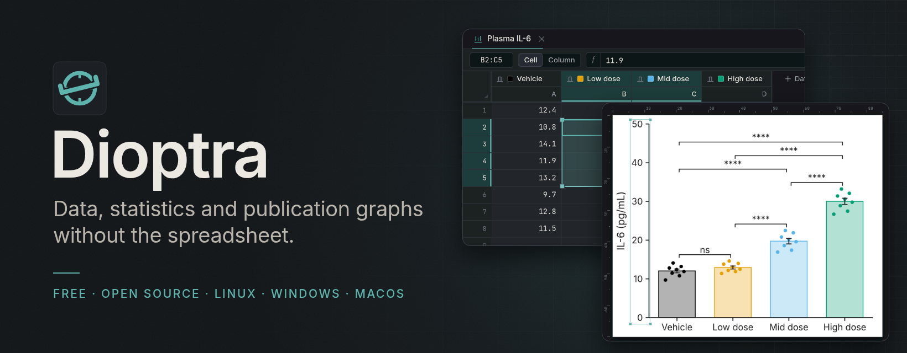
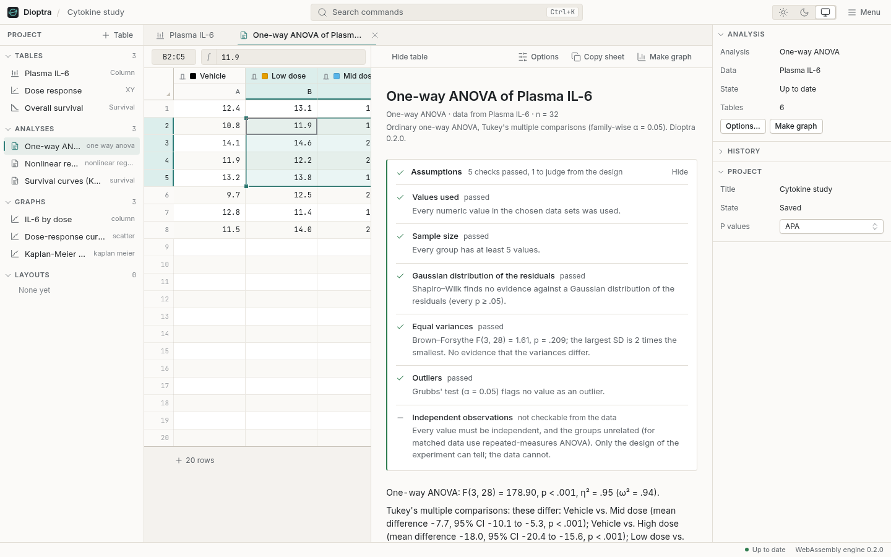
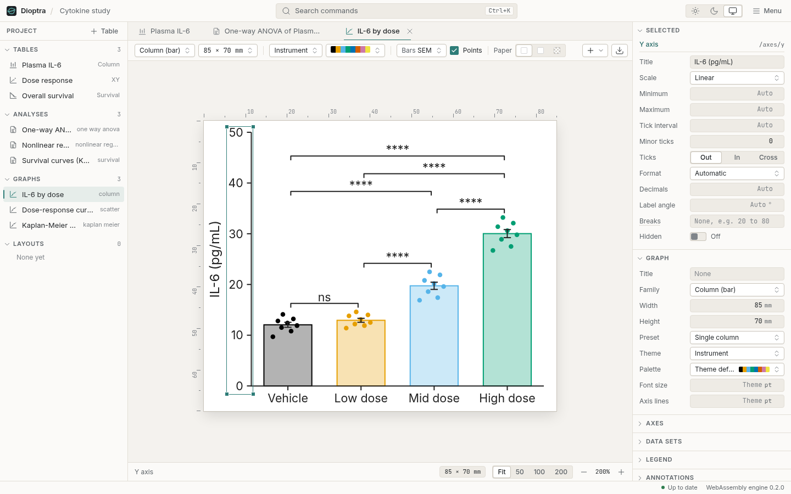
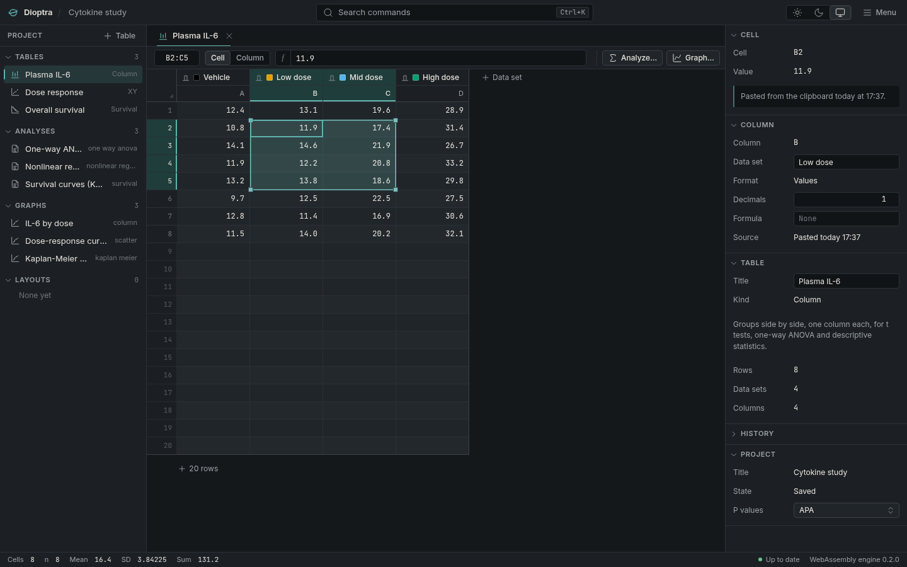
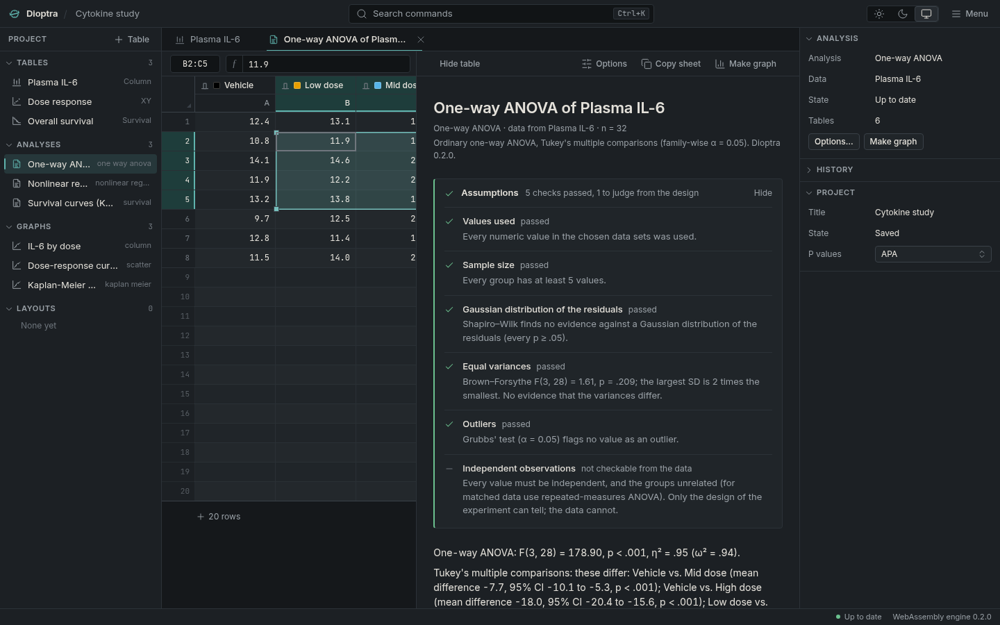
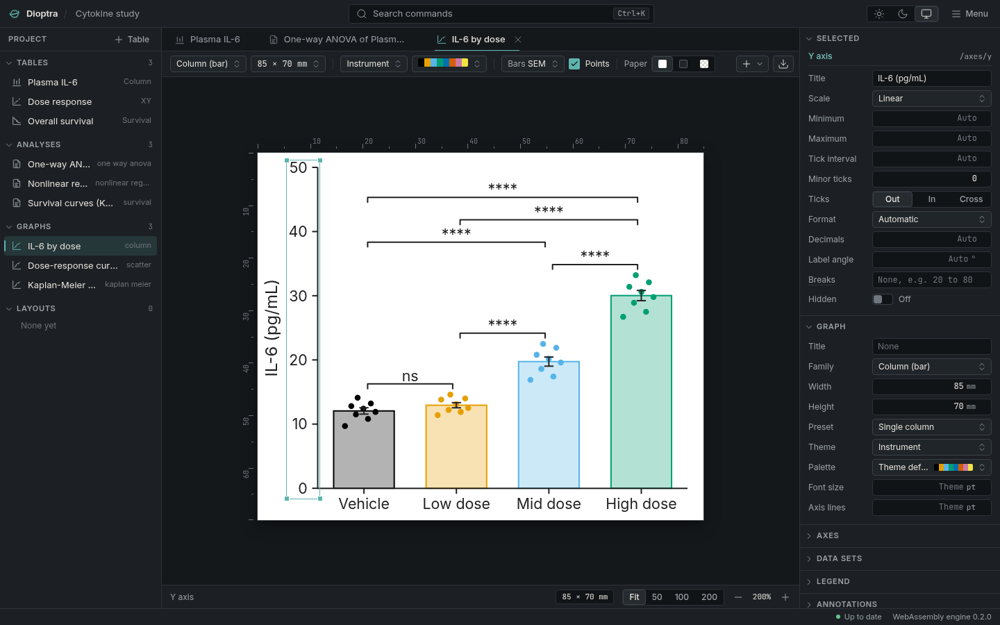
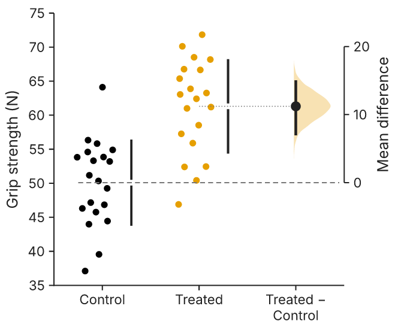

<p align="center">
  
</p>

<p align="center">
  <a href="https://github.com/ZahakJ/dioptra/releases/latest"></a>
  <a href="LICENSE"></a>
  <a href="https://github.com/ZahakJ/dioptra/actions/workflows/ci.yml"></a>
  
</p>

<p align="center">
  <a href="https://zahakj.github.io/dioptra/"><b>Website</b></a> ·
  <a href="https://zahakj.github.io/dioptra/manual/"><b>Manual</b></a> ·
  <a href="https://github.com/ZahakJ/dioptra/releases/latest"><b>Download</b></a>
</p>

Dioptra is a free desktop program for scientific data: paste raw numbers, test them with
every assumption checked, and export a journal-ready figure. It runs on Linux, Windows and
macOS.

<table>
  <tr>
    <td width="33%"></td>
    <td width="33%"></td>
    <td width="33%"></td>
  </tr>
  <tr>
    <td></td>
    <td></td>
    <td></td>
  </tr>
  <tr>
    <td align="center"><sub><b>The grid.</b> Every cell knows where it came from.</sub></td>
    <td align="center"><sub><b>The results sheet.</b> Assumptions first, then sentences to paste.</sub></td>
    <td align="center"><sub><b>The graph editor.</b> Millimetres and points.</sub></td>
  </tr>
</table>

## Why

Most lab data travel from the instrument to a spreadsheet, from the spreadsheet to
GraphPad Prism, and from Prism to Illustrator. Each step can change the data or lose the
record. Spreadsheets turn gene names such as `SEPT2` into dates and copy rounded display
values instead of stored ones. Prism is a good program that many scientists like, but it
is a subscription, it does not run on Linux, it puts some effect sizes behind higher
tiers, and its files are hard to inspect. Dioptra does the work of both in one place: the
data stay as you pasted them, every transform is a stored formula, every analysis shows
its assumption checks, and the project is one open file. The full list of complaints and
answers is the [complaint map](https://zahakj.github.io/dioptra/manual/complaint-map.html).

## Install

Download links always point at the latest release. The file names below are those of
version 0.3.0.

**Linux (AppImage, any distribution)**

```sh
curl -LO https://github.com/ZahakJ/dioptra/releases/latest/download/Dioptra_0.3.0_amd64.AppImage
chmod +x Dioptra_0.3.0_amd64.AppImage && ./Dioptra_0.3.0_amd64.AppImage
```

**Debian, Ubuntu**

```sh
curl -LO https://github.com/ZahakJ/dioptra/releases/latest/download/Dioptra_0.3.0_amd64.deb
sudo dpkg -i Dioptra_0.3.0_amd64.deb || sudo apt-get -f install
```

**Fedora, RHEL, openSUSE**

```sh
curl -LO https://github.com/ZahakJ/dioptra/releases/latest/download/Dioptra-0.3.0-1.x86_64.rpm
sudo rpm -i Dioptra-0.3.0-1.x86_64.rpm
```

**Windows:** download and run
[`Dioptra_0.3.0_x64_en-US.msi`](https://github.com/ZahakJ/dioptra/releases/latest/download/Dioptra_0.3.0_x64_en-US.msi)
(or [`Dioptra_0.3.0_x64-setup.exe`](https://github.com/ZahakJ/dioptra/releases/latest/download/Dioptra_0.3.0_x64-setup.exe)
to install without administrator rights).

**macOS:** download the disk image for your processor,
[`Dioptra_0.3.0_aarch64.dmg`](https://github.com/ZahakJ/dioptra/releases/latest/download/Dioptra_0.3.0_aarch64.dmg)
for Apple silicon or
[`Dioptra_0.3.0_x64.dmg`](https://github.com/ZahakJ/dioptra/releases/latest/download/Dioptra_0.3.0_x64.dmg)
for Intel, and drag Dioptra to Applications. The app is ad-hoc signed but not notarized, so
the first launch needs right-click → Open (on macOS 15 and later: System Settings → Privacy &
Security → Open Anyway), or once in Terminal: `xattr -cr /Applications/Dioptra.app`

The builds are not signed with a paid certificate, so Windows and macOS ask once before
the first launch; [Getting started](https://zahakj.github.io/dioptra/manual/getting-started.html)
says what to click.

## A figure, as exported



## What it does

| Area | In version 0.3.0 |
|---|---|
| Tables | Eight kinds (XY, Column, Grouped, Contingency, Survival, Parts of whole, Multiple variables, Nested); replicate or mean/SD/N entry; a million-cell grid; text kept as text; excluded values kept and struck through; provenance for every cell |
| Formulas | Column and cell formulas with fill-down, summaries, series functions, unit and mass-to-molar conversion; derived tables for pivot, transpose, filter, baseline removal and normalisation |
| Analyses | Twenty, from t tests and ANOVA to nonlinear regression, survival, ROC, Bland–Altman and PCA; assumption checks first, effect sizes with confidence intervals, APA sentences and a methods line |
| Graphs | Twenty-three families including violin, raincloud, estimation, SuperPlot, Kaplan–Meier and volcano; an interactive editor; three themes; colour-blind-safe palettes; multi-panel layouts |
| Paired graphs | Connecting lines on bar, dot, box and violin graphs: a line per subject, the means or medians, or both; colour by data set, subject or a grouping column; a gap or a join at a missing value; grouped tables within or across groups; horizontal graphs; the default graph of paired and repeated-measures tests ([manual](https://zahakj.github.io/dioptra/manual/graphs/connecting-lines.html)) |
| Export | SVG with real text, PDF with embedded fonts, PNG at any resolution; sizes in mm and points; identical bytes on every platform; tables to CSV, TSV and XLSX |
| Import | Paste with decimal-comma detection; CSV, TSV, XLSX, XLS, ODS and Prism `.pzfx` data |
| File format | `.dioptra`: a zip of documented JSON with data, formulas, specifications and the command history ([format](docs/FILE-FORMAT.md)) |
| Command line | `dioptra analyze data.csv --kind column --test one_way_anova`; `run`, `render`, `export` and `bench` on a project file, for scripted pipelines |
| Platforms | Linux (AppImage, deb, rpm), Windows (msi, exe), macOS (Apple silicon and Intel) |

## Correctness

All 58 NIST StRD reference data sets used pass, and 8,327 comparisons against SciPy,
statsmodels, lifelines and scikit-learn agree within tolerance, with no failures; the full
record is in the [correctness chapter](https://zahakj.github.io/dioptra/manual/correctness.html)
([source](docs/CORRECTNESS.md)).

## Building from source

Dioptra is a Rust engine (`crates/`) with a Tauri 2 and React interface (`apps/dioptra`).
[CONTRIBUTING.md](CONTRIBUTING.md) has the setup, and `./verify` runs every check. The
[architecture chapter](https://zahakj.github.io/dioptra/manual/architecture.html) explains
how the parts fit.

## Contributing

Bug reports, numerical discrepancies and pull requests are welcome. Read
[CONTRIBUTING.md](CONTRIBUTING.md) first: numerical changes need a named reference and a
test against a known value. Please follow the [code of conduct](CODE_OF_CONDUCT.md);
security reports go by [SECURITY.md](SECURITY.md).

## Citation

If you use Dioptra in published work, please cite the version you used. The metadata are
in [CITATION.cff](CITATION.cff); GitHub's *Cite this repository* button formats it.

## Licence

[MIT](LICENSE), because it is the licence scientists and their institutions can accept
without review. The bundled Inter typeface is under the SIL Open Font License.
