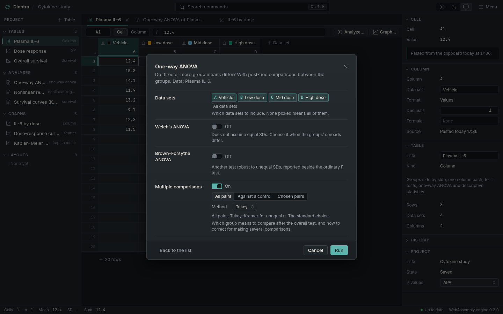

# Statistical analyses: t tests, ANOVA, regression and more

How to run a statistical test in Dioptra: select the data, press Analyze (Ctrl-Shift-A),
choose the test and its options, and read the results sheet, which shows the assumption
checks first and the effect size with its confidence interval.

An analysis in Dioptra is an object in your project, like a table or a graph. It holds a
**specification** (which table, which test, which options) and a **results sheet**
computed from it. Change the data and the sheet recomputes. Change an option and the
sheet recomputes. Delete the analysis and the history still records that it existed.

This page explains the flow, the parts of a results sheet, and the defaults. The
[analysis reference](reference.md) documents each analysis: when to use it, what it
assumes, its options and outputs, its reference, and a worked example.

## The flow

1. **Select data and press Analyze** (Ctrl-Shift-A, or the *Analyze…* button above the
   grid). The list holds all twenty analyses. Those that fit the table kind are active;
   the others are shown greyed with the reason ("needs a contingency table", "needs at
   least three data sets"). You see what exists even when it does not apply.
2. **Choose options.** One compact panel with the few choices that matter, each with one
   line saying what it means. The defaults are the ones a careful statistician would
   choose without knowing more about your experiment.
3. **Run.** The results sheet opens beside the table.
4. **Make a graph** from the sheet with one click. Brackets for comparisons and fitted
   curves come from the analysis and stay linked to it.
5. **Change anything.** The sheet and the graph mark themselves stale and recompute when
   you look at them.

## What a results sheet contains

A results sheet is structured, not a block of text. From top to bottom:

**Assumption checks.** What the test rests on, what was checked, and what the check means
for this result. Collapsed to one line when everything passed; open when something did
not.

**Summary sentences.** The result in words, in the style of a careful methods section:

> Welch's t test: the means differ by 3.2 units (95% CI 1.1 to 5.3), t(17.4) = 3.21,
> p = .005.

The estimate and its confidence interval come first. The p value comes last, as one piece
of evidence among several.

**A methods sentence** you can paste into a paper: which test, which variant, two-sided
or not, which correction for multiple comparisons, how many values were used, and the
Dioptra version.

**Tables.** Every number at full precision, displayed to a sensible number of digits.
Copy a single number, a table, or the whole sheet as tab-separated text or Markdown
(*Copy sheet*).

**Effect sizes with confidence intervals.** Mean differences, Cohen's d and Hedges' g,
eta squared, odds ratios and relative risks, correlation coefficients, hazard ratios, AUC.
In the base product, always shown. An effect size says how big the difference is; a p
value only says whether the data are surprising if there were none.

**A checklist** headed *Before you report this*: the things the test cannot check for you.
Are the values independent? Was the pairing decided before the experiment? Is the
experimental unit the row, or something larger?

## Assumption checks

Every parametric test assumes things about the data: that values are independent, that
they come from a roughly Gaussian distribution, that the groups have similar spreads.
Independence can only be judged from the design, so it goes in the checklist. The rest
can be checked, and Dioptra checks it, at α = 0.05 for every check:

| Check | How | Status |
|---|---|---|
| Normality | Shapiro–Wilk (3 ≤ n ≤ 5000), with D'Agostino–Pearson as a second opinion from n = 8; applied to whatever the test assumes is Gaussian: each group, the paired differences, or the residuals | Pass when every p ≥ .05; caution when the smallest p is between .01 and .05 or only D'Agostino–Pearson objects; fail below .01. Not checked below n = 3 |
| Equal variances | Brown–Forsythe (Levene's test on medians) decides; Bartlett's test is shown beside it | When the test in use does not assume equal variances (Welch), it is shown for information only |
| Sample size | Count per group against the analysis's minimum | Fail below 2 values; caution below the minimum |
| Outliers | Grubbs' test at α = 0.05 on each group | A note only, never a failure: an unusual value is a question for the experiment |
| Values used | How many values were used, and what was left out (empty, text, excluded) | Caution when something was dropped |

A failed check does not stop the analysis. It says what the failure means here and names
the alternative: Welch's ANOVA when variances differ, a rank-based test when the
distribution is far from Gaussian, more data when n is too small.

Two warnings about normality tests, which the sheet repeats where they matter. With small
samples they have little power: a pass at n = 4 tells you almost nothing. With large
samples they detect departures too small to matter, and the t test is robust to those.
Look at the data as well. Use the checks as a prompt, not as an automatic switch; choosing
the test after seeing which one gives the smaller p value is the p-hacking the analysis log
is there to make visible.

## The defaults, and why

**Welch's t test, not Student's.** Student's t test assumes the two groups have equal
variances. When they do, Welch's test gives almost the same answer. When they do not, and
especially when the smaller group has the larger variance, Student's test can be badly
wrong. Welch costs nothing when the assumption holds and protects you when it fails, so it
is the default. Student's test is one click away for anyone who needs it.

**Two-sided.** A one-sided test halves the p value in the direction you predicted and
cannot detect an effect in the other. It is legitimate only when the direction was fixed
before the data were seen and an effect the other way would be treated as no effect. That
is rare, so two-sided is the default, and choosing one-sided adds a sentence to the methods
line saying so.

**Tukey–Kramer for all pairs.** After an ANOVA the default compares every pair of groups
with Tukey–Kramer, which handles unequal group sizes. For each group against a control,
choose Dunnett; for a few pairs chosen in advance, Holm or Šidák. Each of these controls
the chance of any false positive across the family of comparisons, with the most power
available for that question. Plain Bonferroni is available but needlessly
conservative; Holm is uniformly better. Benjamini–Hochberg controls the false discovery
rate instead, for screens with many comparisons.

**Type III sums of squares for two-way ANOVA**, with sum-to-zero coding, so that unbalanced
designs give the answer most textbooks and Prism give. (A frequent error is type III with
dummy coding; Dioptra's tests check that it does not make it.)

**Exact tests when affordable.** Mann–Whitney and Wilcoxon p values are exact when there
are no ties and the samples are small enough to enumerate; Fisher's test is exact for
tables larger than 2 × 2 too; Spearman's p is exact for n ≤ 9. The sheet says which
method produced the p value.

## P-value styles

A p value can be written several ways. The project's style is set once (inspector,
*Project*, *P values*) and applies everywhere: results sheets, summary sentences, and the
labels on graph brackets. Changing it changes them all, and never changes the number
underneath.

| Style | p = 0.0049 | p = 0.00004 | Typical use |
|---|---|---|---|
| APA (default) | p = .005 | p < .001 | Psychology, many biomedical journals |
| NEJM | P=0.005 | P<0.001 | Clinical journals |
| GP | P = 0.0049 (\*\*) | P < 0.0001 (\*\*\*\*) | Matching a Prism figure |
| Exact | p = 0.0049 | p < 0.0001 | Four significant digits |

The GP style uses GraphPad's asterisks: \* < .05, \*\* < .01, \*\*\* < .001,
\*\*\*\* < .0001, decided on the stored value, not the rounded one. It is available because
some journals and labs require it. It is not the default because asterisks turn a
continuous measure of evidence into a grade, and the word "significant" invites the reader
to stop at the grade.

## Reproducibility

Each analysis is saved in the project file as its specification, so reopening the file
recomputes every result from the data. Each run, option change and deletion is a command
in the history (`history.jsonl` inside the file), so the record of what was tried is kept
with what was reported.
