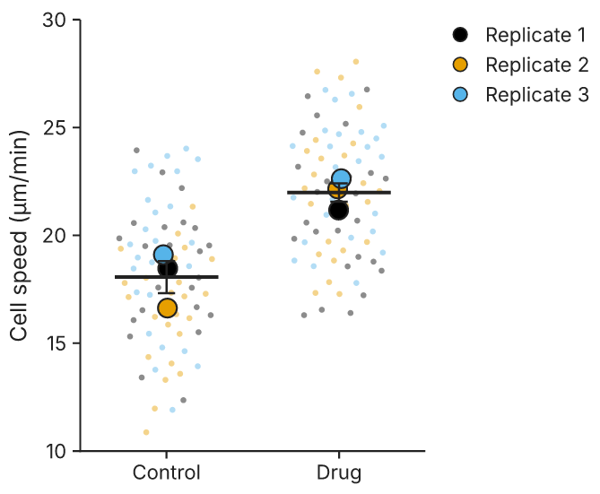

# Data tables

A table in Dioptra is not a blank sheet. It has a **kind**, and the kind says what the rows
and columns mean. That meaning is what lets Dioptra offer the right analyses and draw the
right graph without asking you to explain your experiment twice.

Why not one flat sheet for everything? Because the same six numbers mean different things
in different experiments. Six values in two columns might be two independent groups of
three (an unpaired comparison) or three subjects measured twice (a paired one). The numbers
cannot tell you which; the layout can. Prism made this choice, and it is the part of
Prism people value most once they have learned it (the guided analysis, K1 in the
[complaint map](complaint-map.md)). It is also the part they find hardest to learn (P9).
Dioptra keeps the idea and tries to make the choice easier: each kind is explained in one
sentence with a sketch when you create or paste a table, the paste dialog suggests a kind
from the data, and when in doubt the **Multiple variables** kind is a safe default that
can be reshaped into any other.

## Shared vocabulary

- A **data set** is a named group of columns: one group in a Column table, one Y series in
  an XY table, one variable in a Multiple variables table. Data sets are lettered A, B, C,
  as in formulas.
- A data set has a **subcolumn format**. With *replicate values* each subcolumn holds one
  replicate (`values(3)` is three replicates side by side). With a *summary* format you
  type statistics computed elsewhere: mean, SD and N; mean, SEM and N; mean and a 95%
  confidence interval with N; mean and SD; mean and SEM; median and quartiles; lower and
  upper limits; or a single value. Summary formats exist because published papers and
  instrument software often give you only the summary, and with N present most analyses
  can still be computed exactly.
- **Row titles** label rows: subjects, samples, levels of a factor.
- An **empty cell** is missing, never zero. Zero is a number.

## The eight kinds

### Column

*Groups side by side, one column each.*

| Control | Low dose | High dose |
|---:|---:|---:|
| 12.1 | 15.3 | 21.0 |
| 10.4 | 16.8 | 19.2 |
| 11.7 | 14.1 | 24.6 |

**Use it** for one factor: treatments, genotypes, time points measured in separate
subjects. Rows mean nothing unless the design is paired or repeated, in which case each
row is one subject and you choose a paired analysis.

**Analyses:** descriptive statistics, t tests (one-sample, unpaired Welch or Student,
paired, ratio paired), Mann–Whitney, Wilcoxon, one-way ANOVA (with Welch and
Brown–Forsythe variants), repeated-measures one-way ANOVA, Kruskal–Wallis, Friedman,
normality tests, outliers, correlation, ROC curves, Bland–Altman.
**Default graph:** column (bar) with every point shown. **Prism:** Column table.

### XY

*An X column and one or more Y data sets.*

| Dose (nM) | Control: rep 1 | rep 2 | Treated: rep 1 | rep 2 |
|---:|---:|---:|---:|---:|
| 0.1 | 2.3 | 2.1 | 2.5 | 2.4 |
| 1 | 4.0 | 3.8 | 6.1 | 5.7 |
| 10 | 7.2 | 6.8 | 9.4 | 9.9 |

**Use it** whenever each value has an X coordinate that is a number: dose–response, time
courses, standard curves, calibration. Each Y data set can have replicate subcolumns or a
summary format (mean, SD, N).

**Analyses:** simple linear regression (with confidence and prediction bands and residual
diagnostics), nonlinear regression (the curve-fitting library: 4PL and 5PL, exponential
decay and association, Michaelis–Menten, binding, Gaussian, polynomials, custom equations),
correlation, descriptive statistics, normality, outliers.
**Default graph:** scatter. **Prism:** XY table.

### Grouped

*Rows are levels of one factor, data sets are levels of another, subcolumns are
replicates.*

| | Male: 1 | Male: 2 | Male: 3 | Female: 1 | Female: 2 | Female: 3 |
|---|---:|---:|---:|---:|---:|---:|
| Wild type | 12 | 14 | 11 | 14 | 15 | 13 |
| Knock-out | 9 | 8 | 10 | 8 | 7 | 9 |

**Use it** for two factors at once: genotype by sex, treatment by time. The question it
answers is whether each factor matters and whether they interact.

**Analyses:** two-way ANOVA (type III sums of squares by default, with type I and II
available; repeated measures on rows or columns), descriptive statistics, normality,
outliers. **Default graph:** grouped column. **Prism:** Grouped table.

### Contingency

*Counts of subjects in each combination of two categories.*

| | Cured | Not cured |
|---|---:|---:|
| Drug | 30 | 10 |
| Placebo | 18 | 22 |

**Use it** when each subject falls into one row category and one column category and you
counted them. The cells hold counts, not percentages and not measurements.

**Analyses:** chi-square (with Yates' correction for 2 × 2 as an option), Fisher's exact
test (2 × 2 and larger, by the network algorithm), with relative risk and odds ratio and
their confidence intervals. Dioptra does not rewrite what you paste: a value such as 1.5 is
kept, and the analysis tells you that it expected whole counts (Prism silently turns
"1.23" into "123", P7). **Default graph:** column. **Prism:** Contingency table.

### Survival

*Time in X; for each group, 1 for an event and 0 for a censored observation.*

| Days | Group A | Group B |
|---:|---:|---:|
| 12 | 1 | |
| 30 | | 0 |
| 41 | 1 | |

**Use it** for time-to-event data: one row per subject, the time in X, and in that
subject's group column a 1 if the event happened at that time or a 0 if follow-up ended
without it.

**Analyses:** Kaplan–Meier curves with Greenwood confidence intervals, median survival,
log-rank and Gehan–Breslow–Wilcoxon comparisons, hazard ratios.
**Default graph:** Kaplan–Meier with an at-risk table. **Prism:** Survival table.

### Parts of whole

*One data set of categories that add up to a whole.*

| | Count |
|---|---:|
| Type I | 42 |
| Type II | 17 |
| Type III | 9 |

**Use it** for fractions of a total: cell types in a population, reads per category.

**Analyses:** chi-square goodness of fit against equal proportions.
**Default graph:** column (pie and donut are available, reluctantly: lengths are easier to
compare than angles). **Prism:** Parts of whole table.

### Multiple variables

*One column per variable, one row per case, like a data frame.*

| Age | Sex | BMI | Group |
|---:|---|---:|---|
| 54 | F | 23.1 | control |
| 61 | M | 27.4 | drug |

**Use it** for anything shaped like a spreadsheet of observations, and whenever you are not
sure. Each variable has a declared type: *number*, *category* (text labels such as
"control"), *text* (identifiers and notes, never analysed) or *date*. When you paste, the
type is inferred: all numbers become a number; ISO dates (`2026-10-11`) a date; text with
at most twelve distinct values a category; anything else text. Text stays text: a gene
called `MARCH1` or `SEPT2` is never turned into a date.

**Analyses:** descriptive statistics, t tests, Mann–Whitney and Wilcoxon between numeric
variables, correlation (Pearson, Spearman, Kendall), principal component analysis, ROC,
Bland–Altman, normality, outliers. To compare groups named in a category column, pivot
long to wide: one data set per group (see [Entering and shaping data](entering-data.md)).
**Default graph:** column. **Prism:** Multiple variables table.

### Nested

*Groups as data sets, subgroups (such as animals) as subcolumns, observations stacked
within each.*

| Control: mouse 1 | mouse 2 | Drug: mouse 1 | mouse 2 |
|---:|---:|---:|---:|
| 3.2 | 2.9 | 4.4 | 4.1 |
| 3.5 | 3.1 | 4.0 | 4.3 |
| 3.0 | 3.3 | 4.2 | 3.9 |

**Use it** when you measured several things (cells, fields, wells) within each experimental
unit (animal, culture, patient). This is the table kind that protects you from the most
common error in cell biology: treating 300 cells from three mice as 300 independent
observations. The experimental unit here is the mouse, so n = 2 per group, not 6.

**Analyses:** descriptive statistics per subcolumn, normality, outliers, and t tests and
one-way ANOVA on the subgroup means, which the results sheet says it did. Mixed-effects
models are planned (see the [roadmap](roadmap.md)).
**Default graph:** SuperPlot: every observation small and pale, each unit's mean large,
coloured by unit. **Prism:** Nested table.

## Choosing quickly

Ask three questions.

1. *Do the values have a numeric X?* Yes: **XY** (or **Survival** if X is time to an
   event).
2. *Are they counts of subjects in categories?* Yes: **Contingency** (two classifications)
   or **Parts of whole** (one).
3. *How many grouping factors?* One: **Column**. Two: **Grouped**. One, with several
   measurements inside each unit: **Nested**.

If none of these fits, or the data arrive in long format from another program, use
**Multiple variables** and reshape later. Changing your mind costs nothing: transforms
produce new tables and leave the original as it was.
