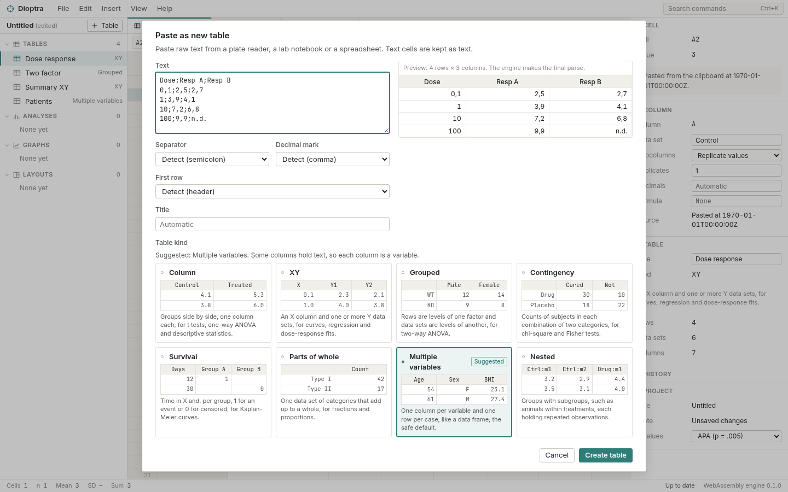
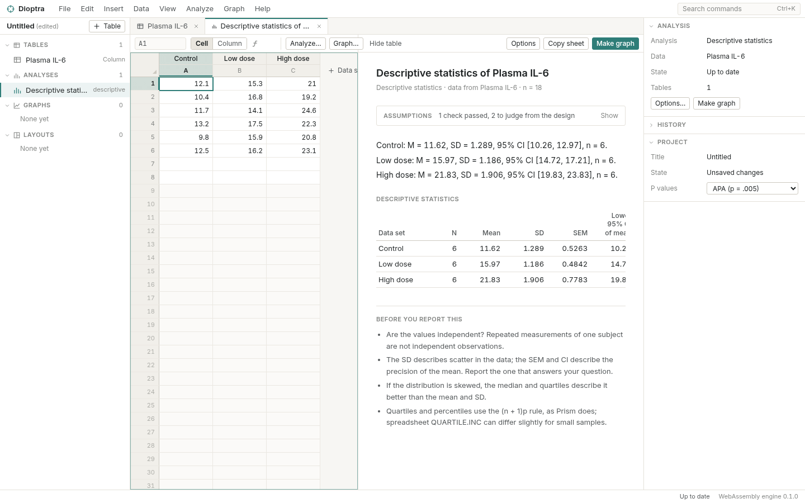
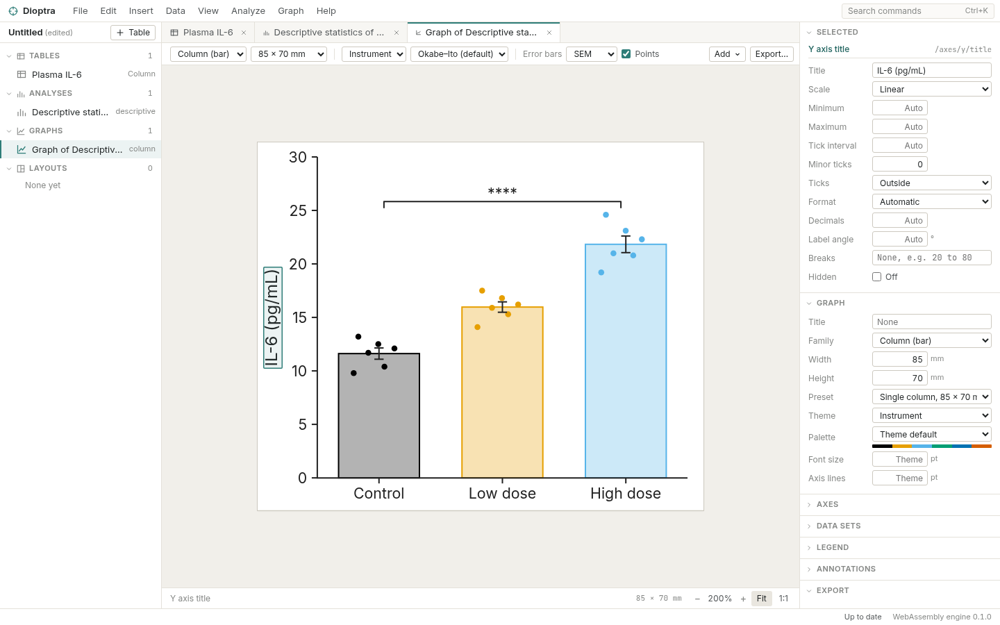
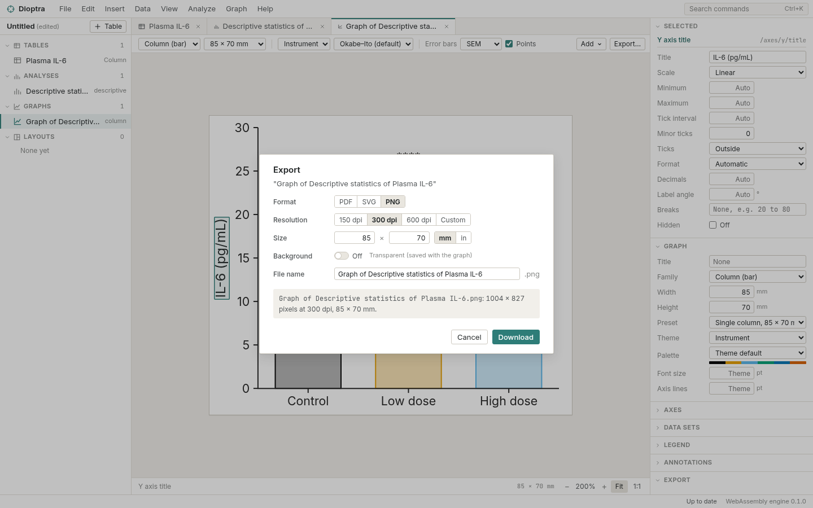

# Getting started

This chapter takes you from nothing to an exported figure: install, paste a small data
set, describe it, test it, draw it, export it, save it. It takes about ten minutes.

## Install

Every release is published on the
[releases page](https://github.com/ZahakJ/dioptra/releases/latest). Pick the file for your
system. The names below are those of version 0.1.0; later versions change only the number.

| System | File | What it is |
|---|---|---|
| Linux, any distribution | `Dioptra_0.1.0_amd64.AppImage` | One self-contained file. Make it executable and run it. |
| Debian, Ubuntu, Mint | `Dioptra_0.1.0_amd64.deb` | A package; installs a menu entry and pulls in WebKitGTK. |
| Fedora, RHEL, openSUSE | `Dioptra-0.1.0-1.x86_64.rpm` | The same, for rpm-based systems. |
| Windows 10 and 11 | `Dioptra_0.1.0_x64_en-US.msi` | The usual Windows installer. |
| Windows, per-user | `Dioptra_0.1.0_x64-setup.exe` | Installs without administrator rights. |
| macOS, Apple silicon (M1 and later) | `Dioptra_0.1.0_aarch64.dmg` | Open, drag Dioptra to Applications. |
| macOS, Intel | `Dioptra_0.1.0_x64.dmg` | The same, for Intel Macs. |

### Linux

The AppImage needs nothing installed:

```sh
curl -LO https://github.com/ZahakJ/dioptra/releases/latest/download/Dioptra_0.1.0_amd64.AppImage
chmod +x Dioptra_0.1.0_amd64.AppImage
./Dioptra_0.1.0_amd64.AppImage
```

If it refuses to start with a message about FUSE, your distribution does not ship
`libfuse2` by default (Ubuntu 22.04 and later). Install it (`sudo apt install libfuse2`),
or use the `.deb`.

On Debian and Ubuntu:

```sh
curl -LO https://github.com/ZahakJ/dioptra/releases/latest/download/Dioptra_0.1.0_amd64.deb
sudo apt install ./Dioptra_0.1.0_amd64.deb
```

On Fedora and other rpm systems:

```sh
curl -LO https://github.com/ZahakJ/dioptra/releases/latest/download/Dioptra-0.1.0-1.x86_64.rpm
sudo dnf install ./Dioptra-0.1.0-1.x86_64.rpm
```

### Windows

Download `Dioptra_0.1.0_x64_en-US.msi` and run it. Windows may show a SmartScreen notice
because the installer is not signed with a paid certificate; choose *More info*, then
*Run anyway*. Dioptra uses the WebView2 runtime that ships with Windows 10 and 11.

### macOS

Download the `.dmg` for your processor (the Apple menu, *About This Mac*, says "Apple M…"
for Apple silicon or "Intel" otherwise), open it and drag Dioptra into Applications. The
first time, macOS may refuse to open an app from an unidentified developer: Control-click
the app, choose *Open*, then *Open* again. macOS remembers the choice.

## Paste your first data

Start Dioptra. You see an empty project: the **project rail** on the left (tables,
analyses, graphs, layouts), the **work area** in the middle and the **inspector** on the
right.

Copy these three columns (from this page, a spreadsheet or a text file; tabs, commas and
semicolons all work):

```text
Control	Low dose	High dose
12.1	15.3	21.0
10.4	16.8	19.2
11.7	14.1	24.6
13.2	17.5	22.3
9.8	15.9	20.8
12.5	16.2	23.1
```

Choose **File → Paste as new table** (Ctrl-Shift-V; ⌘-Shift-V on a Mac). The dialog shows a
preview, what it detected (separator, decimal mark, whether the first row is a header) and
a suggested table kind with a small sketch of each kind. For three groups of replicate
values the right kind is **Column**: each column is a group. Pick it, give the table a
title such as "Plasma IL-6", and press *Create table*.



Click any cell. The inspector says where it came from ("Pasted from the clipboard at …").
The status line at the bottom shows n, mean, SD and sum of the selection.

## Describe it

Press **Analyze** (Ctrl-Shift-A). The list shows every analysis; those that do not fit a
Column table are greyed with the reason. Choose *Descriptive statistics* and run it. The
results sheet opens beside the table: one sentence per group in APA style, then the table
of N, mean, SD, SEM, confidence interval, median and quartiles, then a short list headed
*Before you report this*.



## Test it

Press Analyze again and choose *One-way ANOVA*. The options panel holds the few choices that
matter, each with one line on what it means: which groups, whether to use Welch's ANOVA
(which does not assume equal SDs), and which multiple comparisons to run (Tukey–Kramer for
all pairs by default). Run it.

The sheet starts with the **assumption checks**: normality of residuals and equality of
variances, each with its test result and what it means for this analysis. If one is in
doubt it is open and amber, and it names the alternative (Welch's ANOVA, or
Kruskal–Wallis). Then the summary sentence, with the effect size and its confidence
interval before the p value. Then the ANOVA table and the comparisons.

Change a number in the table. The sheet marks itself stale and recomputes when you look
at it.

## Draw it

On the results sheet press **Make graph**. Dioptra draws a column graph of the three
groups with every data point shown, error bars, and a bracket for each comparison from the
ANOVA, labelled in the project's p-value style.

The graph is a live object. Click the Y axis title and the inspector shows its
properties; type "IL-6 (pg/mL)". Change the family to *Box* or *Violin* in the toolbar; the
data and brackets follow. Choose a theme (*Instrument*, *Night* for slides, *Journal* for
black-and-white print) and a palette.



## Export it

Press **Export** (Ctrl-Alt-E). Choose PDF, SVG or PNG; set the size in millimetres or
inches (85 × 70 mm is a single journal column); for PNG choose the resolution. The dialog
states exactly what will be written, for example "1004 × 827 pixels at 300 dpi, 85 × 70
mm". PDF embeds the fonts; SVG keeps text as text.



## Save it

**File → Save** (Ctrl-S) writes a `.dioptra` file: the table, the formulas, both analyses,
the graph and the history of what you did. Close Dioptra and open the file again; every
result is recomputed from the data and comes out the same.

That is the whole loop. The rest of the manual explains each step in depth.
