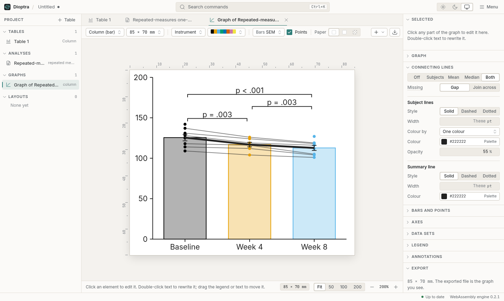
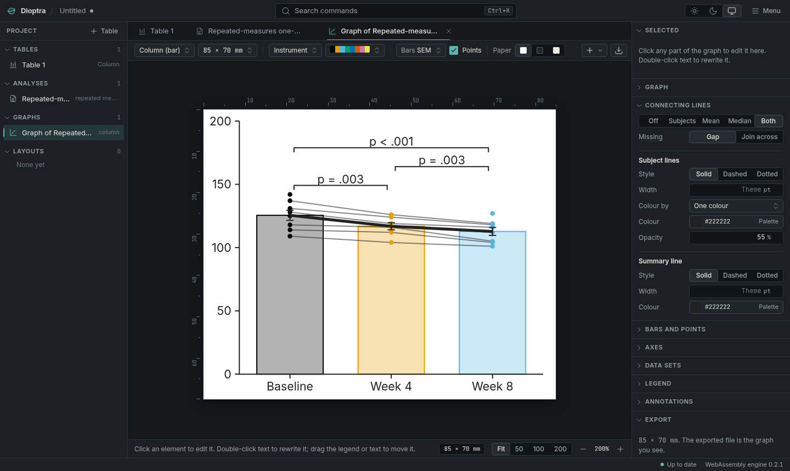
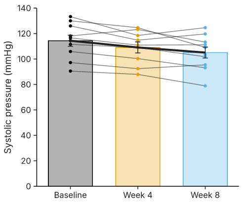
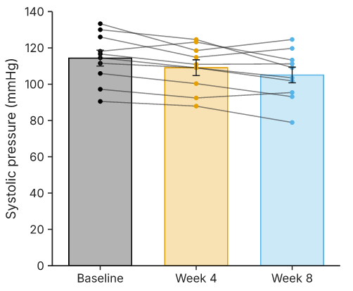
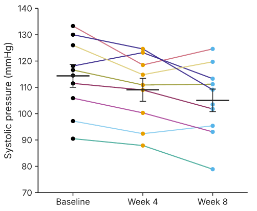
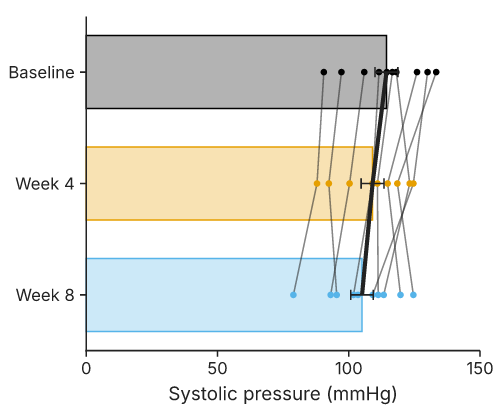
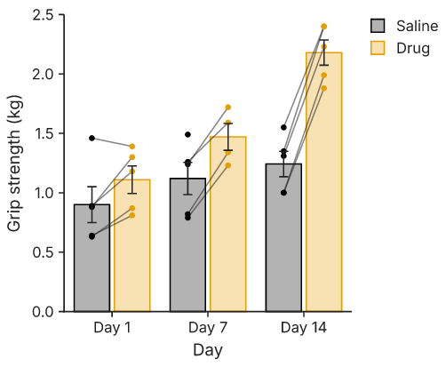

# Connecting lines and paired graphs

## Why a line

Measure the blood pressure of eight people, give them a drug, measure again. Draw two bars
of the mean, before and after, and the bars say the average fell by eight. They do not say
whether everyone fell by eight, or whether two people fell by forty and the rest did not
move. Those are different drugs.

The data know the difference, because each row is one person. A paired test uses that: it
works on each person's own change, and that is why a paired t test can find an effect that
an unpaired test on the same numbers misses. A graph of paired data should show the same
thing the test sees. The way to do it is to draw each person's points and join them with a
line, bar to bar. Parallel lines that all slope down are a consistent effect; lines that
cross every which way are noise around a mean.

Dioptra draws these lines on any bar graph, dot plot, box plot or violin: connecting lines
are an option of the graph, not a separate kind of graph.

## A worked example

Paste eight subjects measured at baseline, week 4 and week 8 into a column table. The
first row becomes the column titles. The third subject missed the week-4 visit, so that
cell is empty.

```text
Baseline	Week 4	Week 8
131	124	118
118	116	105
142		127
109	104	101
125	117	112
137	126	119
114	112	104
128	119	116
```

Run **Analyze → Repeated-measures one-way ANOVA** (or a paired t test on two columns, a
Wilcoxon test or a Friedman test). The results sheet's toolbar button reads **Graph with
connecting lines**: these analyses default to the paired graph. Click it.





You get bars of the mean with SEM error bars, every subject's points on the bar centres,
a thin grey line per subject, and the significance brackets from the analysis. Now open
the **Connecting lines** section of the inspector:

- **Off / Subjects / Mean / Median / Both** chooses what is joined. *Subjects* joins the
  values of each row. *Mean* and *Median* join the summary of each bar instead. *Both*
  draws the subject lines and the line of the graph's summary (the mean, or the median when
  **Bars and points → Summary** says median). In the picture above it is *Both*.
- **Missing** says what an empty cell does. *Gap* (the default) breaks that subject's line
  there; *Join across* connects the values on either side. Subject 3 above has a baseline
  and a week-8 value only, so with *Gap* it draws no line at all: there is no pair of
  neighbouring visits to join. A line from baseline straight to week 8 would hide that the
  week-4 value was never measured; choose *Join across* when that is what you want.
- **Subject lines**: style (solid, dashed, dotted), width in points, opacity, and colour.
  *Colour by* is one colour for every line (Prism's convention), the **data set** (each
  segment takes the colour of the bar it starts from), the **subject** (each row its own
  colour from a palette), or a **grouping column** (a column of the table that says, say,
  *Male* or *Female* for each row: lines take a colour per group, a legend appears, and that
  column is not drawn as a bar).
- **Summary line**: its own style, width and colour.

Everything is undoable, and the graph redraws as you change it. Click a subject line in the
graph to select it: the inspector shows the same controls, and the status line names the
row.





## How lines are matched

Lines join **the values in the same row**, as Prism does. Row 5 in *Baseline* and row 5 in
*Week 8* are the same subject. If your data are in long format (one row per measurement),
pivot them to wide first with **Data → Transform… → Pivot long to wide**.

Lines run **in the order the categories appear** on the axis, which is the order of the
data sets in the table (or of the analysis's chosen data sets). Reorder the columns to
reorder the lines.

## Lines meet the points

When points are jittered sideways so they do not overlap, each line ends at its own
point's jittered position, not at the bar centre, so lines and points always agree. With
**Bars and points → Jitter** at 0 % the points sit on the centre line, the classic
before–after look; the paired preset uses 0 %.



## Every bar style

The same lines work whatever draws the categories. Switch the family in the toolbar and
the connecting lines stay:

| Style | Family | Notes |
|---|---|---|
| Bars with points | `column` | the default for paired analyses |
| Bars only | `column`, *Points* off | subject lines still drawn, from the values |
| Dot plot (scatter) | `strip` | points with a mean or median line |
| Mean ± SD, SEM or 95% CI | `strip`, *Points* off | the summary tick and its error bar |
| Box and whiskers | `box` | lines start at the jittered points, or the centre without points |
| Violin | `violin` | lines join the points inside the violin |

Subject lines are drawn on top of bars, boxes and violins and beneath the points; error
bars and the summary line sit above the points. **Horizontal** (Bars and points →
Orientation) turns the graph so the categories run down the left; the lines turn with it.
Log axes work as usual, and a line that crosses a broken axis is cut at the break, as the
axis is.



## Grouped tables

In a grouped table each row is a group (Day 1, Day 7, Day 14) and each data set has
subcolumns. For repeated measures, subcolumn 1 of every data set is subject 1, subcolumn 2
is subject 2, and so on. **Direction** chooses which way the lines run:

- **Within groups** (default): inside each group, from one data set's bar to the next
  (Saline to Drug on Day 1). This is Prism's before–after on a grouped graph.
- **Across groups**: along each data set, from group to group (Saline on Day 1, Day 7,
  Day 14), Prism's "each replicate". The summary line then takes each data set's colour.



Stacked bars draw no connecting lines: a stacked bar has no single height per data set to
join.

## In the file

A graph with connecting lines is an ordinary column (or strip, box, violin) graph with an
`options.connecting` block; the [graph reference](reference.md) lists every field and the
[file format](../file-format.md) chapter says how graphs of the old *Before–after* family
from Dioptra 0.2 are opened: as the dot plot that draws the same picture.

```json
"options": {
  "jitter": 0,
  "connecting": { "connect": "both", "style": "solid", "colour_by": "single",
                  "opacity": 0.55, "missing": "gap" }
}
```
